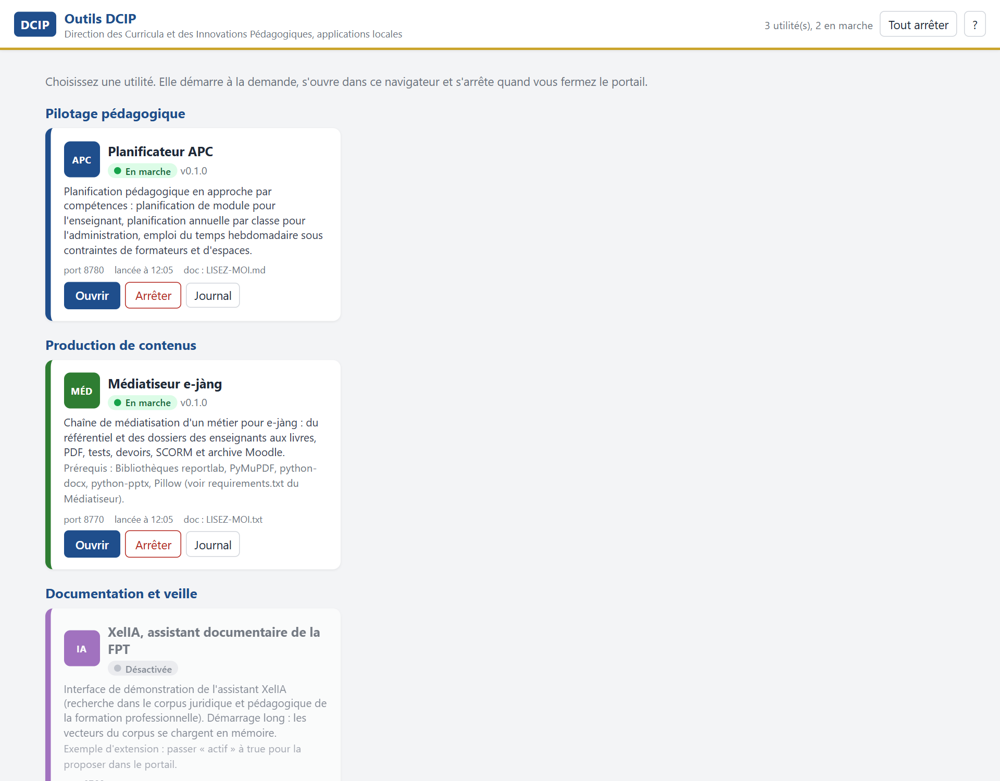
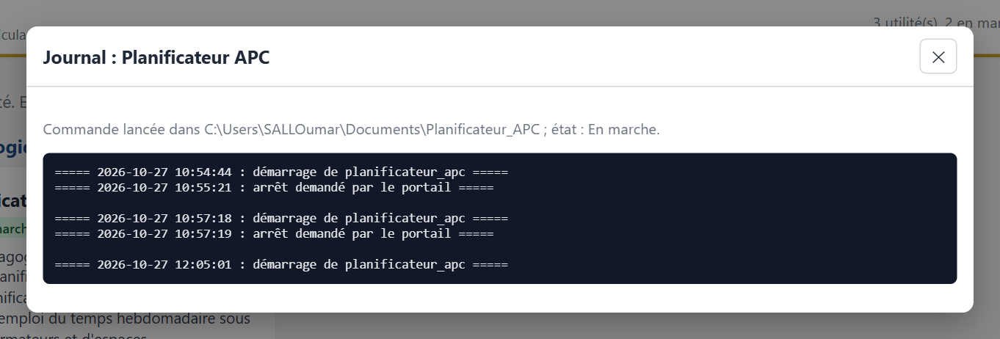

# Les Outils DCIP

Un **portail unique** pour les applications locales de la **Direction des Curricula et des Innovations Pédagogiques (DCIP)**, ministère chargé de la formation professionnelle et technique du Sénégal. Une seule installation, une interface de sélection ; chaque outil démarre à la demande sur le poste, sans connexion.

Au lancement, le portail réunit deux applications :

- **[le Planificateur APC](https://oumarsall3.github.io/planificateur-apc/)** : planification de module pour l'enseignant, planification annuelle par classe pour l'administration, emploi du temps hebdomadaire sous contraintes de formateurs et d'espaces ;
- **[le Médiatiseur e-jàng](https://oumarsall3.github.io/mediatiseur-ejang/)** : du référentiel et des documents des enseignants aux livres, PDF, tests, devoirs, paquets SCORM et archive de cours pour la plateforme e-jàng.

Il est conçu pour en accueillir d'autres : une utilité s'ajoute par un simple fichier de description, sans toucher au portail.

> 🟡 **Version 0.1, diffusée à la communauté de pratique CoP-IPTE** en octobre 2026 : installateur Windows, édition portable, édition macOS.

---

## En images

Le portail. Chaque tuile dit ce que fait l'outil et s'il est en marche ; un bouton le démarre et l'ouvre dans le navigateur, un autre l'arrête.

Le journal d'une utilité : quand un outil ne démarre pas, la cause se lit ici, sans ouvrir de fichier.

---

## Ce qui le caractérise

- **🧭 Une porte d'entrée** : les utilisateurs n'ont plus à connaître les adresses, les ports ni les lanceurs de chaque application ; ils choisissent un outil.
- **⚙️ Chaque outil reste autonome** : lancé dans son propre processus, sur son port, arrêté à la fermeture du portail ; un outil déjà lancé par ailleurs est reconnu et simplement ouvert.
- **🧩 Extensible sans programmation** : une nouvelle utilité se déclare par un fichier de description (nom, dossier, commande, port, ou simple lien) ; le portail n'a besoin d'aucune modification.
- **↩️ Un bouton de retour** dans chaque application ramène au portail.
- **📦 Une seule installation** : programme Windows qui s'installe sans droits d'administrateur ni Python, édition portable sans installation, édition macOS ; les données des utilisateurs survivent à la désinstallation.
- **🔒 Sur le poste, hors ligne** : rien n'est envoyé sur Internet ; les outils d'administration sont masqués aux utilisateurs ordinaires.

---

## La vérification

| Épreuve | Résultat |
|---|---|
| Démarrage des deux outils depuis le portail | en marche, ouverts dans le navigateur, liens de retour fonctionnels |
| Arrêt | propre, sans faux signalement d'échec |
| Installation Windows silencieuse puis désinstallation | raccourcis créés, aucun fichier résiduel |
| Édition portable lancée par son exécutable | les deux outils démarrent depuis leurs exécutables, données créées à côté du programme |
| Édition macOS | construite, non éprouvée sur un Mac par la DCIP |

---

## Voir la présentation

La page de présentation détaillée est disponible ici : **https://oumarsall3.github.io/outils-dcip/**

---

## À propos de ce dépôt

Ce dépôt **présente** le portail et les choix qui le fondent. Il ne publie volontairement **ni son code source, ni ses installateurs, ni aucune donnée**. Les captures proviennent d'un poste de démonstration.

**Conception :** Oumar SALL, Direction des Curricula et des Innovations Pédagogiques, MEFPT, Sénégal.
